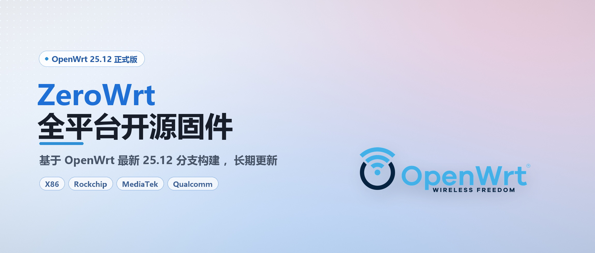

# 图像资源

站点（<https://www.tatalvpai.vip>）用到的图片素材，按用途分目录存放。

## 目录

```
images/
├── README.md            ← 本文件
├── logo/                # 品牌标识
│   ├── logo.png         500×158   RGBA  浅色模式头部 logo
│   ├── logo_dark.png    300×95    RGBA  深色模式头部 logo
│   ├── favicon.ico      16/32/48/64    浏览器标签图标
│   ├── favicon.png      64×64     透明底  备用图标
│   ├── icon.png         148×148   浅底    桌面图标（iOS 主屏幕）
│   ├── icon-180.png     180×180   浅底    iPhone 标准尺寸
│   └── icon-512.png     512×512   浅底    Android / PWA
├── badge/               # 徽章 / 功能图标
│   └── community.png    200×200   RGBA  社区徽章
└── poster/              # 横幅 / 海报背景
    └── zerowrt.jpg      2300×979  JPEG    ZeroWrt 海报 / 首页 Banner
```

---

## 品牌总览

### 站点 logo

<table>
  <tr>
    <td align="center" width="50%">
      <br>
      <sub><b>logo.png</b> · 500×158 · 浅色模式</sub>
    </td>
    <td align="center" width="50%">
      <br>
      <sub><b>logo_dark.png</b> · 300×95 · 深色模式</sub>
    </td>
  </tr>
</table>

### 桌面图标

<table>
  <tr>
    <td align="center" width="33%">
      <br>
      <sub><b>icon.png</b> · 148×148</sub>
    </td>
    <td align="center" width="33%">
      <br>
      <sub><b>icon-180.png</b> · 180×180</sub>
    </td>
    <td align="center" width="33%">
      <br>
      <sub><b>icon-512.png</b> · 512×512</sub>
    </td>
  </tr>
</table>

### 标签图标

<table>
  <tr>
    <td align="center" width="50%">
      <br>
      <sub><b>favicon.ico</b> · ICO · 16/32/48/64</sub>
    </td>
    <td align="center" width="50%">
      <br>
      <sub><b>favicon.png</b> · PNG · 64×64</sub>
    </td>
  </tr>
</table>

> `favicon.ico` 是四个尺寸打包在一个文件里，部分浏览器可能不显示 ICO 预览；`favicon.png` 是透明底 PNG，作备用与社交分享。

---

## 徽章

<table>
  <tr>
    <td align="center" width="50%">
      <br>
      <sub><b>community.png</b> · PNG · 200×200</sub>
    </td>
  </tr>
</table>

透明底功能图标，用于社区入口、板块标识、列表徽标等场景。

---

## 海报展示



<sub><b>poster/zerowrt.jpg</b> · 2300×979 · JPEG · ZeroWrt 海报 / 首页 Banner</sub>

构图：左侧大号标题 + 蓝色胶囊标签，右侧 OpenWrt 官方 logo，粉蓝渐变底。
尺寸与子比主题自带的 `img/slider-bg.jpg` 相同（2300×979），可直接作为幻灯片背景使用。

---

## 规格表

### `logo/`

| 文件 | 尺寸 | 透明底 | 用途 |
| :-- | :-- | :--: | :-- |
| `logo.png` | 500 × 158 | ✓ | 子比主题 `logo_src`（浅色头部） |
| `logo_dark.png` | 300 × 95 | ✓ | 子比主题 `logo_src_dark`（深色头部） |
| `favicon.ico` | 16 / 32 / 48 / 64 | ✓ | 浏览器标签页 |
| `favicon.png` | 64 × 64 | ✓ | 旧浏览器 / 备用 |
| `icon.png` | 148 × 148 | — | 桌面图标（iOS 主屏幕） |
| `icon-180.png` | 180 × 180 | — | iPhone 标准尺寸 |
| `icon-512.png` | 512 × 512 | — | Android / PWA |

### `badge/`

| 文件 | 尺寸 | 格式 | 用途 |
| :-- | :-- | :-- | :-- |
| `community.png` | 200 × 200 | PNG（透明底） | 社区徽章 |

### `poster/`

| 文件 | 尺寸 | 格式 | 用途 |
| :-- | :-- | :-- | :-- |
| `zerowrt.jpg` | 2300 × 979 | JPEG | ZeroWrt 海报 / 首页 Banner |

---

## 配色

| 用途 | 色值 |
| :-- | :-- |
| 主绿（图形块面） | `#1EC216` |
| 粉（JTGY 字标） | `#E56D96` |
| 海报主题色 | 橙 `#F7941E` → `#F58220` |

## 约定

1. **透明底**：logo 与 favicon 一律用 RGBA PNG，不留白底/黑底，深浅两套主题都能用。
2. **尺寸对齐**：logo 宽高比 3.16:1（500×158 / 1000×316）；海报 2300×979。
3. **命名**：`xxx.png` 给浅色模式，`xxx_dark.png` 给深色模式，后缀不要改。
4. **新增文件**：同步更新上面的展示区和规格表。

## 直接引用

```
https://raw.githubusercontent.com/MinimaxFlora/Website_Resources/master/images/logo/logo.png
https://raw.githubusercontent.com/MinimaxFlora/Website_Resources/master/images/logo/logo_dark.png
https://raw.githubusercontent.com/MinimaxFlora/Website_Resources/master/images/logo/favicon.ico
https://raw.githubusercontent.com/MinimaxFlora/Website_Resources/master/images/logo/icon.png
https://raw.githubusercontent.com/MinimaxFlora/Website_Resources/master/images/badge/community.png
https://raw.githubusercontent.com/MinimaxFlora/Website_Resources/master/images/poster/zerowrt.jpg
```

> 浏览器会缓存 favicon，换图标后按 `Ctrl/Cmd + Shift + R` 强制刷新。

## 授权

仓库内的图形标识归 **疆途光影** 所有，仅用于本站及本站关联项目，未经许可请勿转载使用。
